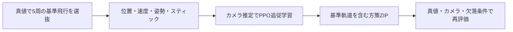

# Ghost Racer

M1 MacBook Pro 上で、65 mm 級 Tiny Whoop の ACRO 周回飛行を PPO で学習する環境です。Gazebo の真値で同じ設定から2回とも5周を完走した候補を比較し、平均タイムが最短の設定から軌道と操作を保存します。PPOはゲート欠落と位置ずれを含むカメラ推定状態でその操作への補正を学びます。内寸1 m四方の8ゲートを配置したヘアピンと高低差を含む固定コースで、5周のタイム短縮を目指します。

カメラは 1/3型 CMOS・2.1 mm M7 レンズを想定し、対角160°、樽型歪み、NTSC 相当の 4:3 映像（640×480、60 fps）でシミュレーションします。操縦送信の目標は40〜60 Hzです。



## 起動

Docker Desktop を起動し、Python 3.11 と Make が利用できる状態で実行します。初回は公式 Betaflight コンテナ定義を取得してビルドします。

```sh
make start
```

1. [学習設定](http://127.0.0.1:8766/)で機体質量・カメラ取付角・総学習ステップ数・ロールアウト長・エピソード時間・乱数シードを指定します。総ステップ数はロールアウト長の倍数です。
2. **学習 Start** を押すと Docker 内で学習が続きます。画面には基準飛行の候補と回数、次にPPOの「現在 / 最大 ステップ」が表示されます。ステップ予算はすべて追従学習に使います。完了までブラウザを閉じて構いません。
3. [学習結果](http://127.0.0.1:8766/#results)で評価飛行を選ぶと、軌跡、高度、速度、通過数、周回タイム、PnP 成功率と終了理由を確認できます。「機体カメラとゲート検出」で飛行を再生・一時停止し、スライダーでコマを選べます。検出表示を外すと元の FPV 映像を確認できます。保存方策の真値飛行、カメラ推定飛行、ゲート付近で検出を0.20・0.35・0.50秒落とした飛行を比較できます。

早期終了の既定はオフです。「第1ゲート通過」または「5周完走」を選ぶと、評価間隔・評価飛行数・必要成功回数を指定できます。既定では8ロールアウトごとに5飛行を評価し、4回成功した時点で学習を終了します。評価中は「完了した評価飛行数 / 評価飛行数」と成功回数を表示します。16,384ステップ・ロールアウト長128で評価間隔を8にすると、1,024ステップごとに最大16回の評価を行います。5周完走を目標にした実行でも、各評価飛行のゲート通過数を比較して序盤の進歩を確認できます。

走行中の速度と高度にソフトウェア上限はありません。ゲートを正しい順序で速く通過するほど報酬が増えます。コース変更はリポジトリの [ゲート定義](sim/course.json) で行います。

| 操作 | コマンド |
| --- | --- |
| カメラの PnP と RC による離陸の確認 | `make smoke` |
| 初期操舵のみの飛行 | `make demo` |
| CLI から学習・評価 | `make train`、`make evaluate` |
| サービス停止 | `make stop` |

ブラウザの結果は `runs/sessions/<実行ID>/`、CLI の方策は `runs/ppo.zip` に保存されます。CLI とブラウザは同じシミュレータを使うため、飛行は一度に一つ実行してください。構成図、報酬式、モデルと実機の前提は [技術概要と開発ガイド](docs/architecture.md) にまとめています。
