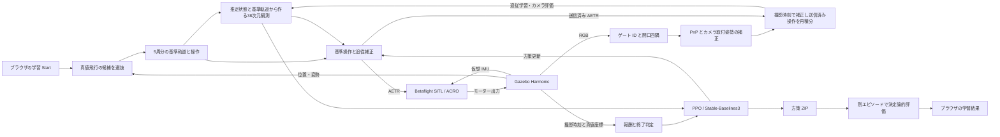
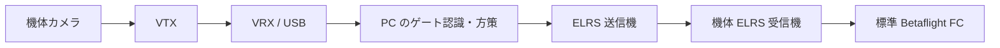
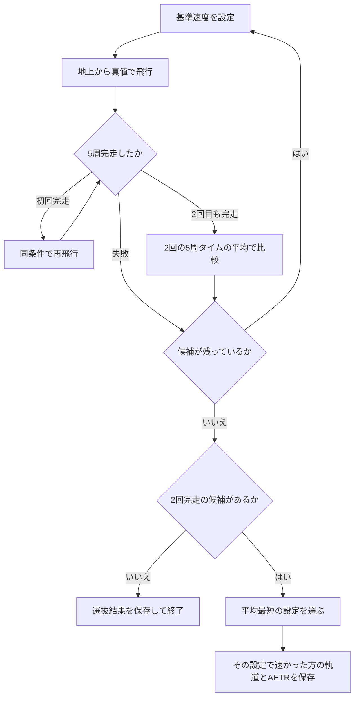
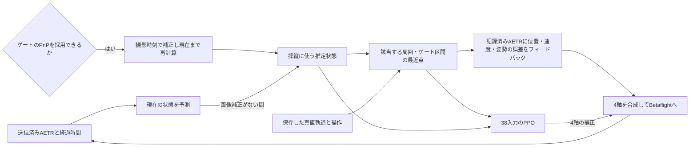

# Ghost Racer 技術概要と開発ガイド

開発対象は、FPV 映像と既知のゲート配置から次の ACRO スティック入力を決める PC 側の方策です。Gazebo が 65 mm 級機体の物理とカメラを計算し、Betaflight SITL が角速度制御とモーター配分を実行します。

## 学習環境と実機の境界

実機では次の信号経路を想定しています。今回実装した範囲はシミュレーションと学習・評価です。実機のフライトコントローラーには標準 Betaflight を使用し、PC から送信機への入力方式は使用機種に合わせて実装します。

### M1 Mac の構成

Betaflight のコミット `a3495a384f801ffaedc188188c1cae85dad11f39` の公式 Gazebo コンテナ定義を取得し、ハッシュを照合してビルドします。その上にプロジェクトのシミュレータ用ブリッジ、SITL とローター力学を追加します。公式の Gazebo パッケージ指定に合わせて Gazebo は linux/amd64、SITL バイナリと PPO 学習サービスは M1 の Linux VM に合わせて arm64 で実行します。描画はヘッドレス EGL、学習は CPU です。仮想時計の同期パッチはシミュレータ用です。 [公式コンテナ定義](https://github.com/betaflight/betaflight/blob/a3495a384f801ffaedc188188c1cae85dad11f39/.devcontainer/containerfile.gazebo)・[ビルドスクリプト](../scripts/build.sh)・[Compose](../compose.yaml)

## 固定コースと機体

既定コースには内幅1.00 m・内高1.00 mのゲートが8個あり、2〜4番の法線方向が 0° → 90° → 180° と変わるヘアピン、その後に低い5番と S 字が続きます。ゲート中心高度は 0.78〜1.35 m。最初の1番通過で計時を開始し、全ゲートを順に通って1番に戻ると1周です。5周完走には合計41回の正方向通過が必要です。 [ゲート定義](../sim/course.json)

| JSON 項目 | 意味 |
| --- | --- |
| `version` | スキーマ番号。現在は整数 1 |
| `gates` | 通過順の配列。6〜16ゲートで末尾から先頭につながる |
| `center` | 床を基準にしたワールド座標 [X, Y, Z]、単位 m |
| `yaw_deg` | 通過方向の水平角。+X が 0°、反時計回りが正 |
| `opening` | 内幅・内高さ、単位 m |

開発者が JSON を変更したら `python3 sim/build_course.py` で参照ワールドを再生成します。各学習ジョブは開始時のゲート列を複製し、その配置を描画・採点・自己位置推定・再評価で共有します。機体質量の既定値は26 g。推力と空気抵抗は65 mm 級の近似値です。ACRO の4入力はロール、ピッチ、スロットル、ヨーの順で、スティックの物理範囲を 1000〜2000 µs 相当に変換します。 [コース生成](../sim/circuit.py)・[機体モデル](../sim/models/whoop/model.sdf)・[SITL 設定](../sim/bridge/sitl.cli)

## 画像から機体位置を求める

1. 取付角は学習設定の「機体と操縦」で指定します。0°が機体の正面、正が上向きで、範囲は−90〜+90°、既定は40°です。設定した角度を仮想カメラとPnPの座標変換に共用し、結果画面に表示します。機体カメラは1/3型 CMOS、2.1 mm M7 レンズを想定します。公称160°は対角画角と仮定し、NTSC デコード後の 4:3 映像を 640×480 正方画素、毎秒60枚の RGB フレームで近似します。コンポジット信号の変調・色にじみ・フィールド間の時間差はモデル化の範囲外です。Gazebo で透視投影し、受信側で通常レンズの放射歪みを加えます。FPV の描画対象から自機の外観を除き、画面左右への機体の映り込みを防ぎます。画面の隅で理想像の半径が25%縮む樽型を仮定しました。1/3型・焦点距離・M7 は実機の公称仕様です。シミュレーションの実効焦点距離（画素単位）は対角160°と歪みから定めます。実レンズの内部パラメータと歪み係数は校正で置き換えられます。 [カメラモデル](../sim/optics.py)・[OpenCV の投影モデル](https://docs.opencv.org/4.x/d9/d0c/group__calib3d.html)
2. 歪みを補正した画像でゲートを検出し、得られた開口四隅を元の画像座標に戻して録画表示と歪み係数付き PnP に渡します。ゲートの四隅付近に個別 ID の ArUco タグを配置します。タグからゲートを識別して平面射影を推定し、オレンジの枠の内側輪郭から抽出した四角形と照合します。枠の一部が画面外の場合は複数タグから開口四隅を推定します。十分な大きさの単一タグだけが見える場合は、その実測角で姿勢を求め、既知の開口を再投影します。タグ付きゲートの位置、向き、寸法が既知であることが前提です。
3. 開口四隅とインライア判定を通ったタグ角の画素座標・ワールド座標を OpenCV の `solvePnP` に渡します。カメラの背後に点がある解や再投影誤差の大きな解を除き、取付角とオフセットを取り除いて機体位置・姿勢を求めます。
4. 初期位置と方位は既知の離陸位置から設定します。直前に送った4軸の ACRO 入力、経過時間、機体質量を使い、機体角速度・姿勢・推力・速度・位置を予測します。PnP が成功すると、撮影時刻で予測を補正してから現在までの入力を再積分します。位置・姿勢の急激な飛びは棄却します。26 gの模擬機で操作と真値を12秒間記録し、ホバースロットル54.8%、ロール・ピッチ応答0.08秒、ヨー応答0.18秒、推力応答0.04秒を近似値として採用しました。未検出が続くほど誤差は蓄積します。 [状態予測](../learning/navigation.py)・[26 g機のSITL応答測定CSV](../runs/calibration-26g.csv)
5. 次のゲートまでのコース中心線上で最近点と先読み点を求めます。推定軌跡が開口を順方向に横切れば次ゲートへ仮に進み、再観測後にゲート面の前後関係を確認します。推定の交点が開口から外れた場合も、進入側でそのゲートに接近した履歴があり、再観測位置がゲート面を越えて出口側の中心線に戻ったときに通過を回復します。カメラ航法の仮判定には推定誤差を考慮して各辺に15 cmの許容幅を持たせます。採点側は真値の軌跡を使い、指定の開口内を機体半径分の余裕を持って通過した場合に報酬と通過数を加算します。
6. 現行版のPPOは、カメラ推定状態と真値飛行で事前に記録した基準軌道から観測を作ります。現在飛行中の機体の真値は、基準飛行の作成、追従誤差とゲート通過の採点、真値入力を選んだ比較評価で利用します。 [観測と操縦](../learning/policy.py)

### カメラと操縦の周期

カメラはシミュレーション時刻で60 fps に設定します。受信、ゲート検出、操作送信を独立させ、処理待ちの古い画像をため込まず最新の処理可能な画像を使います。新しいスティック入力の送信目標は実時間で40〜60 Hzです。処理時間に応じて目標周期を16.7〜25 msに調整します。Betaflight に同じ入力を再送する周期は別に約10 msです。結果画面に生成・受信 fps（シミュレーション時間）、受信 fps・実送信 Hz（実時間）、25 ms超過回数、使用画像の撮影から指令までの経過時間の95パーセンタイル（シミュレーション時間）が表示されます。 [通信](../learning/client.py)・[ブリッジ](../sim/bridge/simulation.py)

## 5周の基準飛行とカメラでの追従学習

### 1．真値で完走できる基準軌道を選ぶ

Gazebo の機体位置・姿勢を読み、連続サンプルの差から速度・角速度を求めます。操縦器は次ゲートまでの中心線の最近点を探し、先読み点への方向と速度偏差から必要な加速度、姿勢、スロットルを計算します。第1ゲートまでは直線進入し、高度に応じて前進を強めます。真値での操縦にはゲート検出を必要としません。 [コース参照](../learning/navigation.py)・[真値での操縦](../learning/policy.py)

基準速度は1.5、1.85、2.2 m/sを試し、どれも条件に届かなかった場合は1.2 m/sも試します。これは操縦器の速度目標で、実際の飛行速度に上限はありません。タイムは最初のゲート通過から5周目のフィニッシュまでのラップタイムの合計です。離陸から最初のゲートまでの操作も記録します。採用するのは試した候補の中で平均タイムが最短のものです。全候補が失格なら結果に飛行記録と終了理由を残して終了します。 [選抜と記録](../learning/train.py)

### 2．推定状態で基準軌道を追う

基準飛行の各操作区間について、通過済みゲート数、開始時刻、始点・終点の位置、開始時の速度・姿勢、送ったAETRを記録します。飛行中は推定した累計通過数で同じ周回のゲート区間を選び、推定位置をその区間の折れ線に投影します。ヘアピンへの到着が遅れれば、参照する旋回操作も実際の進入に合わせて遅れます。 [基準軌道の検索](../learning/reference.py)

PPOの学習中はエピソードごとに、ゲート接近時の意図的な画像欠落を0、0.20、0.35、0.50秒から選びます。さらにワールド座標のX・Y・Zごとに−0.10〜+0.10 mの位置ずれを一様分布から選び、初期推定位置とその飛行のPnP測定位置に同じずれを加えます。ゲート未検出中は送信済み操作から予測した状態で同じ方策を動かします。目標判定と最終評価では人工の位置ずれを外し、検出欠落は評価条件に従います。方策ZIPに基準軌道と選抜結果を同梱し、再評価時にも同じ操作を参照します。 [学習と保存](../learning/train.py)・[推定・指令生成](../learning/policy.py)

## 学習済みモデルの入力と出力

現行モデル（`race_version=3`）は各周期に38値を受け取り、ロール・ピッチ・スロットル・ヨーの補正量を返します。0–24は従来の25入力モデルと同じ特徴、25–37が実際の基準飛行との差とその地点のスティックです。 [モデルの観測](../learning/policy.py)

### 1回の推論に渡す38個の値

入力は形状 `(38,)`、型 `float32` の配列です。下表の添字は0始まりで両端を含みます。機体座標の3成分は順に **X＝前、Y＝左、Z＝上** です。たとえばゲートへの相対位置 `[1.0, 0.3, 0.0]` は、水平な機体から見てゲート中心が前方1 m、左0.3 m、同じ高さにある状態です。

| 添字 | 入力 | 単位と符号の読み方 |
| --- | --- | --- |
| 0–2 | 機体から次ゲートの中心へ向かうベクトル | m、機体座標 |
| 3–5 | 機体から中心線上の先読み点へ向かうベクトル | m、機体座標 |
| 6–8 | 機体から中心線上の最近点へ向かうベクトル | m、機体座標。Yが正なら戻るべきラインは機体の左 |
| 9–11 | 最近点から先読み点へ向かう進行方向 | 無次元、機体座標。前方の直線では `[1, 0, 0]` |
| 12–14 | 機体の並進速度 | m/s、機体座標。Xが正なら前進 |
| 15–17 | ワールドの鉛直上向き単位ベクトルを機体座標で表した値 | 無次元。水平姿勢で `[0, 0, 1]` |
| 18–20 | 機体X・Y・Z軸まわりの角速度 | 各成分を300 °/s（約5.236 rad/s）で割った値。例として `0.5` は正方向の150 °/s |
| 21–24 | 前回送信した最終スティック指令 | 各軸 −1〜+1、AETR順。リセット直後は `[0, 0, -1, 0]` |
| 25–27 | 基準折れ線上の最近点 − 現在の推定位置 | m、機体座標 |
| 28–30 | 基準飛行の速度 − 現在の推定速度 | m/s、機体座標 |
| 31–33 | 現在の姿勢から基準姿勢への相対回転ベクトル | rad、機体座標 |
| 34–37 | この区間で基準飛行が実際に送った4軸 | −1〜+1、AETR順 |

### 4軸の補正量から送信値を求める

評価時の `model.predict(obs, deterministic=True)[0]` は、形状 `(4,)`、各軸 −1〜+1 の補正量を返します。順序は **A＝ロール、E＝ピッチ、T＝スロットル、R＝ヨー** です。同じ保存方策と同じ入力なら評価時の出力は同じです。学習時は探索のために操作をサンプリングします。 [学習と評価の呼び出し](../learning/train.py)

v3の基準スティック値は、記録済みAETRに位置・速度・姿勢の偏差を戻す補正を加えた値です。各軸について、基準値を `b`（−0.98〜+0.98）、モデルの補正量を `r`（合成前に−0.9999〜+0.9999に制限）とすると、合成値は `u = tanh(atanh(b) + atanh(r))` です。補正量が0なら基準値がそのまま残ります。送信値は `round(1500 + 500 × u)` に相当する1000〜2000の整数です。1500はロール・ピッチ・ヨーでは中立、スロットルではスティックの50%を表します。次の推論の添字21–24には、この整数を−1〜+1に戻した値が入ります。 [指令の合成](../learning/policy.py)・[RCチャンネルへの変換](../learning/env.py)

### 旧版の25入力モデルでの推論例

2,048ステップ学習した保存方策に、比較用に設定した2通りの状態をオフラインで入力しました。どちらも26 gの機体が第1ゲートの1 m手前を水平・前向きに1.5 m/sで飛び、角速度は0です。直前の指令は `[0, 0, 0.096, 0]` とし、Bだけ機体位置をラインの右へ0.30 m移しました。以下はこの方策の決定論的な推論値です。 [使用した保存方策](../runs/sessions/20261124T143320-c5203679/policy.zip)

| 入出力（配列内は上表の順序） | A．ライン中央 | B．右に0.30 m |
| --- | --- | --- |
| 入力 0–2／ゲート中心まで | `[1, 0, 0]` | `[1, 0.3, 0]` |
| 入力 3–5／先読み点まで | `[0.55, 0, 0]` | `[0.55, 0.3, 0]` |
| 入力 6–8／ラインまで | `[0, 0, 0]` | `[0, 0.3, 0]` |
| 入力 9–24／両条件で共通 | `[1,0,0, 1.5,0,0, 0,0,1, 0,0,0, 0,0,0.096,0]` | Aと同じ |
| 初期操舵の基準値 | `[0, 0, 0.0960, 0]` | `[-0.1306, 0, 0.0960, 0]` |
| **モデルが返した補正量** | `[-0.0549, 0.0415, -0.0964, 0.0042]` | `[-0.0322, 0.0496, -0.1190, -0.0103]` |
| **合成・丸め後のRC送信値** | `[1473, 1521, 1500, 1502]` | `[1419, 1525, 1488, 1495]` |

Bでは初期操舵が左ロールを要求し、モデルが同じ向きに補正した結果、ロール送信値が1473から1419に変わりました。飛行リプレイの `aetr` は、この合成・丸め後の4軸を−1〜+1で記録した値です。

## PPO の学習目標

記録した操作と追従誤差のフィードバックを基準に、PPO が推定状態から4軸の連続補正量を学習します。飛行速度と高度に上限はありません。水平方向の場外、離陸後の接地、枠接触、取り逃し、ディスアーム、停止は試行の終了条件です。エピソード時間はシミュレーション秒で指定します。

| 報酬の要素 | 計算 |
| --- | --- |
| 進捗 | 次ゲート中心までの距離が減った量。ゲートの切り替え位置で区間を分割 |
| 正順の通過 | +5 に、区間の基準距離を前回通過からの所要時間で割った値を加算。最初は離陸地点を起点に計算 |
| 軌道追従（v3） | 真の通過区間で測った基準軌道までの距離（m）× 経過秒数を減点 |
| 経過時間 | 毎秒 −0.08 |
| 失敗終了 | −3 |

同一区間を短時間で正しく通過するほど報酬が増えます。方策ネットワークと価値ネットワークは各64ユニット×2層。既定は8192ステップ、128ステップの経験を集めるごとに GAE でアドバンテージを推定し、クリップ付き PPO で6エポック更新します。学習率は 0.0003、割引率は 0.99、GAE λ は 0.95、クリップ幅は 0.2 です。 [学習処理](../learning/train.py)・[採点](../learning/env.py)・[PPO の解説](https://spinningup.openai.com/en/latest/algorithms/ppo.html)

### 学習進捗と早期終了

基準飛行の選抜中は候補速度と飛行回数を表示します。その後の進捗の分子は PPO が収集した学習ステップ数、分母は設定した最大ステップ数です。ブラウザは約2秒ごとに更新します。早期終了は任意です。指定ロールアウト数ごとの方策更新後と最終更新後に、同じコースを決定論的な操縦で指定回数飛行し、その評価バッチの成功数を数えます。成功条件は第1ゲート通過または5周完走です。必要回数に届いた方策を保存して終了します。届かなければ、新しい飛行から同じ方策・オプティマイザで学習を続けます。評価飛行は学習ステップに含めません。目標判定にはカメラ推定を使います。保存後は同じ方策を真値、通常のカメラ推定、ゲート接近時に0.20・0.35・0.50秒ずつ検出を落とすカメラ推定の計5条件で評価します。結果画面の上面図では、飛行軌跡と採用した真値の基準軌道（破線）を重ねて比較できます。「基準軌道からのずれ p95」は、真の通過区間で測った3次元の位置偏差の95パーセンタイルです。推定位置と真値との差を表す「推定位置誤差 p95」と併せて確認できます。

## 実行・検証・成果物

- `make start` で起動し、ブラウザの **学習 Start** から実行します。API は 8766 番の `POST /api/runs`、シミュレーションの reset / step は 8765 番です。 [学習画面](http://127.0.0.1:8766/)
- 各ジョブを `runs/sessions/<実行ID>/` に保存します。`run.json` は設定・終了理由・PPO の更新統計、`trace-N.json` は飛行時刻・位置・累計通過数、`policy.zip` は再読込できる方策です。学習終了後に保存モデルを読み直し、探索ノイズを加えず別の飛行を評価します。「完了」は学習と再評価の終了を示します。競技成績は完了周回数と周回タイムで読み取ります。 [結果画面](http://127.0.0.1:8766/#results)
- `make smoke` は Gazebo の FPV でゲート四隅・PnP と RC 離陸を確認します。`python3 sim/build_course.py --check` は参照ワールドの一致を確認し、`.venv/bin/python -m unittest -v learning.test_racing` は周回・接触・高度・設定などを検証します。
- CLI では `make train` と `make evaluate` が使用できます。評価に `--state-source teacher` を追加すると教師入力、`--dropout-seconds 0.35` を追加するとカメラ入力での欠落試験を再現できます。ブラウザで学習した方策の反復評価には `.venv/bin/python -m learning.train evaluate --model runs/sessions/<実行ID>/policy.zip --episodes 5` を使います。

### 基準軌道と追従学習のSITL検証（v3）

2026年11月25日、ブラウザの開始APIから32ステップ（1ロールアウト、seed 7、26 g、仰角40°）の動作確認を実行しました。真値による候補選抜の結果は次の通りです。 [実行記録](../runs/sessions/20261124T154118-dabb7792/run.json)

| 基準速度 | 5周完走数 | 1回目の5周タイム | 2回目の5周タイム |
| --- | ---: | ---: | ---: |
| 1.50 m/s | 2 / 2 | 75.860秒 | 75.856秒 |
| 1.85 m/s | 2 / 2 | 62.950秒 | 62.944秒 |
| 2.20 m/s | 2 / 2 | 54.316秒 | 54.314秒 |

採用した54.314秒の飛行は、離陸を含む41区間・4,287操作です。追従学習の32ステップでは位置ずれを含む推定状態を使いました。この短い飛行は第1ゲート接近前に予算へ達したため、選ばれた0.50秒の欠落条件で実際に除外されたフレームは0枚でした。保存モデルの再評価では、真値で5周53.596秒、通常カメラで4ゲート、0.20・0.35・0.50秒の欠落条件で各2ゲートを通過しました。カメラの4条件はすべて枠接触で終了しました。各条件1飛行の動作確認で、長い学習後の完走率は未測定です。

同じZIPを読み直した追加検証では、位置ずれと欠落を有効にして256ステップのPPO更新を実行しました。54操縦ステップが意図的な欠落中に入り、1エピソードで最大52枚の検出を除外して48エポック更新しました。この追加検証はメモリ上で行い、上記の保存モデルと結果は32ステップ時点のものです。

### 60 fps・状態予測版のSITL検証（v2）

2026年11月24日にM1 MacでPPOを64ステップ（32ステップ×2、seed 7）学習し、保存した同一方策を各条件で1回ずつ飛ばしました。1周は8ゲートで、最初のゲート通過を計時開始とします。 [実行記録](../runs/sessions/20261124T142503-466346be/run.json)

| 操縦に使った状態 | 完了周回 | 実通過数 | 終了 | 推定位置誤差 p95 |
| --- | ---: | ---: | --- | ---: |
| Gazebo 真値 | 5 | 41 | 完走（76.374秒） | 0.365 m（並行する推定器） |
| カメラ推定 | 2 | 20 | 枠に接触 | 0.458 m |
| カメラ推定・接近時に0.20秒欠落 | 1 | 15 | 枠に接触 | 0.498 m |
| カメラ推定・接近時に0.35秒欠落 | 1 | 15 | 枠に接触 | 0.584 m |
| カメラ推定・接近時に0.50秒欠落 | 0 | 4 | 枠に接触 | 0.799 m |

撮影数はシミュレーション時間で約60 fps、受信数は同じ時計で59.94〜60.00 fpsでした。実時間の受信は42.0〜45.3 fps、操作送信は平均53.2〜55.7 Hzでした。各飛行で25 msを超える送信間隔があり、使用画像の撮影から指令までの経過時間は95パーセンタイルで66〜68 ms（シミュレーション時間）でした。各条件1飛行の成績であり、5周完走率の測定には反復試験が必要です。

左右に固定していた白い領域は、自機の描画をFPVカメラから除いて解消しました。左右下部の同じ範囲で、旧録画の23枚では98%超のフレームで白かった画素が左1,778・右1,701個ありました。改修後の飛行録画から抽出した100枚では左右とも0個でした。

### 初回の統合試験

仰角40°・8ゲートの環境でブラウザから128ステップを実行し、32ステップずつ4回のロールアウト、計24エポックの更新、ZIP 保存、再読込、評価記録を確認しました。独立評価は1.734秒で第1ゲートを取り逃し、通過0回、完了0周、最高水平速度2.954 m/s、PnP 成功フレーム48.1%でした。5周の終了判定は既知の41通過の軌跡を使うテストで検証しています。この旧版の方策は5周完走に至りませんでした。

### カメラ映像による失敗解析

ブラウザの各学習エピソードと評価飛行に、操縦に使った各フレームの RGB 画像、シミュレーション時刻、検出した開口四隅、目標ゲート、PnP の成否、入力履歴とPnPによる推定位置、直前の AETR を記録します。未検出フレームも含みます。画像は診断用に JPEG 圧縮し、飛行単位の `camera-N.sqlite` に保存します。採点側の軌跡と同じフレーム番号で高度を照合できます。再生中の緑枠は目標ゲート、黄枠は他の検出ゲートです。チェックを外すと元のカメラ映像を表示します。教師飛行で表示する推定誤差とPnP採用率は並行して動かした推定器の診断値です。CLIは旧版の31入力・25入力モデルも、それぞれの観測形式で評価します。既存の録画は記録時の映像を再生します。

初回評価は第1ゲートの面を高度0.272 mで横切りました。開口の下端は0.350 m、機体半径を含む通過判定の下限は0.401 mです。同じ保存方策を録画付きで別途評価した際にも、終盤の0.400秒間は PnP の更新が途切れ、最終フレームで方策が使った高度は約0.46 m、Gazebo の高度は約0.13 mでした。結果画面の「保存方策の追加評価（録画付き）」で確認できます。
