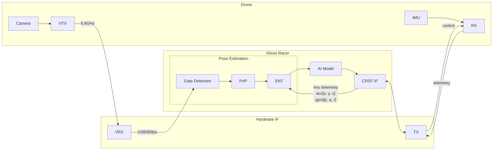

# Ghost Racer 技術仕様書
## 概要

## 自己位置推定(Pose Estimation)
### Gate Detection
※未実装

### PnP
※未実装

### EKF（Extended Kalman Filter）
カメラによるゲート観測情報とIMUの観測情報を統合し、機体の位置・速度・姿勢およびIMUのバイアスを推定する。

#### 入力
| 入力値 | 取得元 | 要素数 | 単位 |
| --- | --- | ---: | --- |
| 加速度（比力） | FCのIMUテレメトリ | 3 | m/s² |
| 機体角速度 | FCのIMUテレメトリ | 3 | rad/s |
| 機体位置 | ゲート検出・PnP | 3 | m |
| 機体姿勢 | ゲート検出・PnP | 4 | Quaternion |
| 観測共分散 | PnP観測の信頼度評価 | - | - |
| 計測時刻 | 各観測データのタイムスタンプ | 1 | s |

#### 状態ベクトル
| 状態変数 | 記号 | 要素数 | 座標系 |
| --- | --- | ---: | --- |
| 機体位置 | p | 3 | 世界座標系 |
| 機体速度 | v | 3 | 世界座標系 |
| 機体姿勢 | q | 4 | 機体座標系から世界座標系への回転 |
| 加速度バイアス | ba | 3 | 機体座標系 |
| 角速度バイアス | bg | 3 | 機体座標系 |
| 合計 | | 16 | |

#### 共分散行列
| 行列 | 内容 | サイズ |
| --- | --- | --- |
| P | 状態推定誤差共分散 | 16 × 16 |
| Q | プロセスノイズ共分散 | 12 × 12 |
| R | 観測ノイズ共分散 | 7 × 7（位置・姿勢観測時） |

#### 状態予測（Prediction）
IMU観測値の取得時に実行する。
- 加速度・角速度のバイアス補正
- 角速度による機体姿勢の予測
- 加速度の座標変換および重力補償
- 機体速度・位置の予測
- 状態共分散行列の更新

#### 観測更新（Update）
PnPによる有効な観測値の取得時に実行する。
- 観測残差の算出
- 観測共分散に基づく外れ値判定
- 状態ベクトルおよび共分散行列の更新
- Quaternionの正規化および共分散の整合

カメラの撮影時刻に対応する状態を補正し、最新のIMU計測時刻まで再予測する。

#### バイアス補正
加速度バイアスおよび角速度バイアスは、EKFの状態変数として継続的に推定する。
- 加速度補正：a_corrected = a_imu - ba
- 角速度補正：omega_corrected = omega_imu - bg
- バイアスの時間変動はランダムウォークモデルで表現する。
- FC側で補正済みの観測値については残留バイアスを推定する。

補正済み角速度は機体姿勢の予測および飛行制御AIへの入力に使用する。

#### 出力
| 出力値 | 算出元 | 要素数 | 単位 |
| --- | --- | ---: | --- |
| 機体位置 | EKF推定状態 | 3 | m |
| 機体速度 | EKF推定状態 | 3 | m/s |
| 機体姿勢 | EKF推定状態 | 4 | Quaternion |
| 機体角速度 | IMU角速度 − 推定角速度バイアス | 3 | rad/s |
| 加速度バイアス | EKF推定状態 | 3 | m/s² |
| 角速度バイアス | EKF推定状態 | 3 | rad/s |
| 状態共分散 | EKF内部状態 | 16 × 16 | - |
| 推定時刻 | 状態予測時刻 | 1 | s |
| 推定状態の有効性 | 共分散・観測状態から判定 | 1 | Boolean |

機体角速度はEKFの直接的な推定値ではなく、バイアス補正済みのIMU観測値とする。
機体座標系のまま出力する。

#### 学習環境モック
学習環境ではゲート検出、PnPおよびEKFの演算を省略し、
Gazeboから取得した機体状態の真値に推定誤差を加えることで、
自己位置推定システムの出力を再現する。

##### 入力
| 入力値 | 取得元 | 要素数 |
| --- | --- | ---: |
| 機体位置 | Gazebo Ground Truth | 3 |
| 機体速度 | Gazebo Ground Truth | 3 |
| 機体姿勢 | Gazebo Ground Truth | 4 |
| 機体角速度 | Gazebo Ground Truth | 3 |
| ゲートの位置・姿勢 | コース定義情報 | - |
| シミュレーション時刻 | Gazebo | 1 |

##### 再現する誤差特性
| 項目 | 内容 |
| --- | --- |
| ランダムノイズ | 位置・速度・姿勢・角速度の観測誤差 |
| バイアス | IMUの残留バイアスと時間変動 |
| ドリフト | ゲート観測が得られない間の推定誤差の蓄積 |
| 推定遅延 | 状態履歴を使用した出力遅延 |
| ゲート検出失敗 | 距離・視野・観測角度に基づく確率的な判定 |
| ゲート再検出 | 蓄積した推定誤差の部分的な補正 |
| 状態共分散 | 推定誤差に応じた疑似共分散 |
| 更新周波数 | 実際の自己位置推定システムの更新周期 |
| 推定状態の有効性 | 疑似共分散および観測状態に基づく判定 |

##### 動作仕様
- 通常モードとモックモードで出力形式、単位、座標系を統一する。
- 推定誤差の時間的な連続性および状態間の相関を考慮する。
- ゲート検出失敗中も状態更新を継続する。
- ゲート再検出時に推定誤差を完全にゼロへ戻さない。
- 姿勢誤差はQuaternionに微小回転を適用して再現する。
- 角速度はバイアス補正済みIMU観測値に相当する値を生成する。
- 誤差特性および更新周波数を設定情報として外部から指定する。
- エピソード開始時に内部状態を初期化する。
- 乱数シードを指定することで再現性を確保する。
- 時刻管理にはGazeboのシミュレーション時刻を使用する。
- 報酬計算および衝突判定にはGazeboの真値を使用する。
- Betaflight SITLに入力するIMUデータはモックの対象外とする。
- モックの誤差パラメータは実際のEKFの評価結果に基づいて調整する。

## AI Model 構成
### 入力（Observation）
| 入力項目 | 要素数 | 単位 |
| --- | ---: | --- |
| 目標ゲートに対する機体の相対位置（X, Y, Z） | 3 | m |
| 機体の移動速度（X, Y, Z） | 3 | m/s |
| 機体の姿勢（Roll, Pitch, Yaw） | 3 | rad |
| 機体の角速度（Roll, Pitch, Yaw） | 3 | rad/s |
| 次のゲートの相対位置（X, Y, Z） | 3 | m |
| 次のゲートの相対Yaw角 | 1 | rad |
| 前回のRoll指令 | 1 | - |
| 前回のPitch指令 | 1 | - |
| 前回のYaw指令 | 1 | - |
| 前回のThrottle指令 | 1 | - |
| 合計 | 20 | |

### 出力（Action）
| 出力項目 | 値の範囲 | 内容 |
| --- | --- | --- |
| Roll | -1.0 ～ 1.0 | Roll方向の操作量 |
| Pitch | -1.0 ～ 1.0 | Pitch方向の操作量 |
| Yaw | -1.0 ～ 1.0 | Yaw方向の操作量 |
| Throttle | 0.0 ～ 1.0 | スロットル操作量 |

### ネットワーク構造（Network Architecture）
全結合型ニューラルネットワーク（MLP：Multi-Layer Perceptron）を採用する。
| 項目 | 仕様 |
| --- | --- |
| モデル | MLP（Multi-Layer Perceptron） |
| 入力層 | 20ニューロン |
| 隠れ層 | 3層 |
| 隠れ層のニューロン数 | 各64ニューロン |
| 隠れ層の活性化関数 | Tanh |
| 出力層 | 4ニューロン |
| 出力形式 | 連続値（Continuous Action Space） |

ネットワーク構造は以下のとおりとする。
| 層 | ニューロン数 | 活性化関数 |
| --- | ---: | --- |
| Input Layer | 20 | なし |
| Hidden Layer 1 | 64 | Tanh |
| Hidden Layer 2 | 64 | Tanh |
| Hidden Layer 3 | 64 | Tanh |
| Output Layer | 4 | Linear |

各層は全結合層（Fully Connected Layer）とする。
出力層から得られる連続値を、各制御コマンドの定義範囲に変換する。

## 学習方法
### 学習アルゴリズム
PPO（Proximal Policy Optimization）による深層強化学習を採用する。

| 項目 | 仕様 |
| --- | --- |
| 学習方式 | 深層強化学習（Deep Reinforcement Learning） |
| 学習アルゴリズム | PPO |
| 学習ライブラリ | Stable-Baselines3 |
| 学習環境インターフェース | Gymnasium |
| 学習モデル | Actor-Critic |
| 行動空間 | 連続値（Continuous Action Space） |

- Actorは機体状態から制御コマンド（RPYT）を決定する。
- Criticは現在の状態の価値を推定する。
- シミュレーション内で飛行を繰り返し、累積報酬の期待値が最大となるようにモデルを更新する。
- 理想的な飛行軌道および制御コマンドの教師データは使用しない。
- 学習完了後、推論にはActorのみを使用する。

### 学習環境
物理シミュレーター上にドローンおよび飛行コースを配置し、強化学習環境を構築する。
| 項目 | 仕様 |
| --- | --- |
| 物理シミュレーター | Gazebo |
| フライトコントローラー | Betaflight SITL |
| 飛行モード | ACRO |
| 学習環境インターフェース | Gymnasium |
| 機体状態の取得 | 物理シミュレーターの真値（Ground Truth） |
| 機体の操作 | 制御コマンド（RPYT） |
| 自己位置推定 | 学習初期は実施しない |

学習時は自己位置推定はモックが出力した再現値を利用する。
- "自己位置推定/EKF/学習環境モック"を参照

物理シミュレーターでは以下の特性を再現する。
- 機体の質量および慣性
- 重力
- 空気抵抗
- モーターの推力特性
- モーターの応答特性

Betaflight SITLでは以下の処理を再現する。
- PID制御
- RatesおよびExpo
- IMUのフィルタリング
- 制御コマンドの処理

学習の処理手順は以下のとおりとする。
- シミュレーション環境を初期化する。
- 機体状態および目標ゲートの情報を取得する。
- Actorに観測値を入力する。
- Actorが制御コマンドを出力する。
- 制御コマンドをBetaflight SITLに送信する。
- 物理シミュレーションを進行させる。
- 機体状態を取得し、報酬を計算する。
- ゲート通過時は目標ゲートを更新する。
- 飛行経験を蓄積し、PPOによってモデルを更新する。

### 初期状態
学習エピソードごとに機体の初期状態をランダムに設定する。

| 項目 | 初期化方法 |
| --- | --- |
| 機体位置 | 飛行可能範囲内でランダムに設定 |
| 機体姿勢 | 所定の範囲内でランダムに設定 |
| 機体速度 | 所定の範囲内でランダムに設定 |
| 機体角速度 | 所定の範囲内でランダムに設定 |
| 目標ゲート | 機体の初期位置に応じて選択 |
| 前回の制御コマンド | 初期状態と整合する値を設定 |
| FC内部状態 | エピソード開始時に初期化 |

初期状態のランダム化により、特定の飛行経路に依存せず、
さまざまな機体状態から目標ゲートへ飛行する制御方策を学習する。

初期状態の具体的なランダム化範囲は別途定義する。

### 報酬関数
飛行速度、ゲート通過精度、飛行安定性および安全性を
評価する報酬関数を定義する。

| 評価項目 | 評価内容 | 報酬 |
| --- | --- | --- |
| ゲートへの接近 | 目標ゲートまでの距離の減少 | 正 |
| ゲート通過 | 正しい方向および順序でのゲート通過 | 正 |
| コース完走 | 全ゲートの通過 | 正 |
| ゲート通過位置 | ゲート中心からのずれ | 負 |
| 経過時間 | 飛行時間の増加 | 負 |
| 機体角速度 | 過度な機体の回転 | 負 |
| 制御コマンドの変化量 | 急激な操作量の変化 | 負 |
| 衝突 | ゲート、床、天井、壁などへの衝突 | 負 |
| 飛行範囲逸脱 | 定義された飛行可能範囲からの逸脱 | 負 |

各ステップにおける報酬は、各評価項目の重み付き合計とする。

報酬の重みは、飛行速度、ゲート通過精度および
飛行安定性のバランスを考慮して調整する。

報酬の具体的な計算式および重みは別途定義する。

### エピソード終了条件
以下のいずれかの条件を満たした場合、エピソードを終了する。

| 終了条件 | 終了種別 |
| --- | --- |
| 全ゲートの通過 | Terminated（成功） |
| 障害物への衝突 | Terminated（失敗） |
| 飛行可能範囲からの逸脱 | Terminated（失敗） |
| 制御不能状態への移行 | Terminated（失敗） |
| 制限時間の超過 | Truncated |
| 最大ステップ数の超過 | Truncated |

エピソード終了後は、機体状態およびフライトコントローラーの
内部状態を初期化し、次のエピソードを開始する。

### ドメインランダム化
シミュレーションと実機の物理特性および観測特性の差異に
対応するため、ドメインランダム化（Domain Randomization）を採用する。

| 対象 | ランダム化項目 |
| --- | --- |
| 機体 | 質量 |
| 機体 | 重心位置 |
| 機体 | 慣性モーメント |
| 機体 | 空気抵抗係数 |
| モーター | 推力係数 |
| モーター | 応答時間 |
| モーター | 最大回転速度 |
| バッテリー | 電圧低下に伴う推力変化 |
| 通信 | 制御コマンドの伝送遅延 |
| 通信 | 通信間隔のばらつき |
| 自己位置推定 | 位置推定誤差 |
| 自己位置推定 | 速度推定誤差 |
| 自己位置推定 | 姿勢推定誤差 |
| 自己位置推定 | 推定値の更新遅延 |
| IMU | 観測ノイズ |
| IMU | 観測値の取得遅延 |

物理パラメータは原則としてエピソードごとにランダム化する。

観測ノイズ、推定誤差および通信遅延については、
実際の発生特性に応じてエピソード中も変動させる。

学習初期は物理シミュレーターから取得した真値を使用し、
学習の進行に応じて観測誤差および通信遅延を導入する。

各パラメータのランダム化範囲は実機の計測結果に基づいて定義する。

### ハイパーパラメータ
PPOの初期ハイパーパラメータを以下のとおりとする。

| 項目 | パラメータ | 初期値 |
| --- | --- | --- |
| 学習率 | learning_rate | 0.0003 |
| ロールアウトステップ数 | n_steps | 2048 |
| バッチサイズ | batch_size | 64 |
| 更新エポック数 | n_epochs | 10 |
| 割引率 | gamma | 0.99 |
| GAEパラメータ | gae_lambda | 0.95 |
| クリッピング範囲 | clip_range | 0.2 |
| エントロピー係数 | ent_coef | 0.01 |
| 価値関数損失係数 | vf_coef | 0.5 |
| 最大勾配ノルム | max_grad_norm | 0.5 |
| 総学習ステップ数 | total_timesteps | 未定 |
| 並列環境数 | n_envs | 未定 |

ActorおよびCriticのネットワーク構成を以下のとおりとする。

| 項目 | Actor | Critic |
| --- | --- | --- |
| 入力層 | 20 | 20 |
| 隠れ層 | 64 × 3層 | 64 × 3層 |
| 活性化関数 | Tanh | Tanh |
| 出力層 | 4 | 1 |

入力値は正規化し、正規化に使用したパラメータは
学習済みモデルとともに保存する。

上記のハイパーパラメータは暫定値とし、
学習結果および飛行性能に基づいて調整する。

## 推論
### 推論周波数
| 項目 | 仕様 |
| --- | --- |
| 推論周波数 | 50 Hz（暫定） |
| 推論周期 | 20 ms |
| 制御コマンド送信周波数 | 50 Hz（暫定） |
| 推論モデル | 学習済みActor |
| 推論方式 | 決定論的推論（Deterministic Inference） |

学習時の制御コマンド更新周波数と実機での推論周波数は統一する。

フライトコントローラー内部のPID制御周波数は、
AIの推論周波数とは独立して設定する。

推論処理および制御コマンドの送信処理は、
設定された推論周期内に完了すること。

### 入力値の取得
| 入力項目 | 取得元 |
| --- | --- |
| 機体位置 | 自己位置推定システム |
| 機体速度 | 自己位置推定システム |
| 機体姿勢 | 自己位置推定システム |
| 機体角速度 | IMU |
| 目標ゲートの位置・姿勢 | コース定義情報 |
| 次のゲートの位置・姿勢 | コース定義情報 |
| 前回の制御コマンド | アプリケーション内部で保持 |

取得した入力値に対して以下の処理を実施する。

- 各観測値のタイムスタンプを確認する。
- 必要に応じて時刻同期および遅延補償を行う。
- 定義された座標系へ変換する。
- 目標ゲートおよび次のゲートに対する相対値を計算する。
- 前回送信した制御コマンドを入力値に追加する。
- 学習時と同一の正規化処理を実施する。
- 観測ベクトルを生成する。

観測値が無効、または許容時間を超過している場合は、
安全制御処理へ移行する。

### 制御コマンドの送信
AIモデルから出力された制御コマンド（RPYT）を
フライトコントローラーへ送信する。

| 項目 | 値の範囲 |
| --- | --- |
| Roll | -1.0 ～ 1.0 |
| Pitch | -1.0 ～ 1.0 |
| Yaw | -1.0 ～ 1.0 |
| Throttle | 0.0 ～ 1.0 |

制御コマンドの送信処理は以下のとおりとする。

- AIモデルから制御コマンドを取得する。
- 制御コマンドを定義された値の範囲に変換する。
- 制御コマンドの有効性を確認する。
- 通信プロトコルに対応するデータ形式へ変換する。
- フライトコントローラーへ送信する。
- 送信した制御コマンドをアプリケーション内部に保持する。
- 保持した制御コマンドを次回の推論時に入力する。

フライトコントローラー側で目標角速度への変換、
PID制御およびモーターミキシングを実施する。

通信断、推論異常、観測値の異常および推論周期の超過に
対応するフェイルセーフを別途定義する。

## コース
| JSON 項目 | 意味 |
| --- | --- |
| `version` | スキーマ番号。現在は整数 1 |
| `gates` | 通過順の配列。6〜16ゲートで末尾から先頭につながる |
| `center` | 床を基準にしたワールド座標 [X, Y, Z]、単位 m |
| `yaw_deg` | 通過方向の水平角。+X が 0°、反時計回りが正 |
| `opening` | 内幅・内高さ、単位 m |
